# ABF New Companies — staff guide

How to use the app day to day. The same help is inside the app under your initials (top
right) → **Help**.

**In short:** every morning the app collects yesterday's new UK companies. You choose who
gets a letter, print the letters (and labels if you need them), post them, and tell the app
they went out. Each company only ever gets one letter.

---

## 1. Signing in

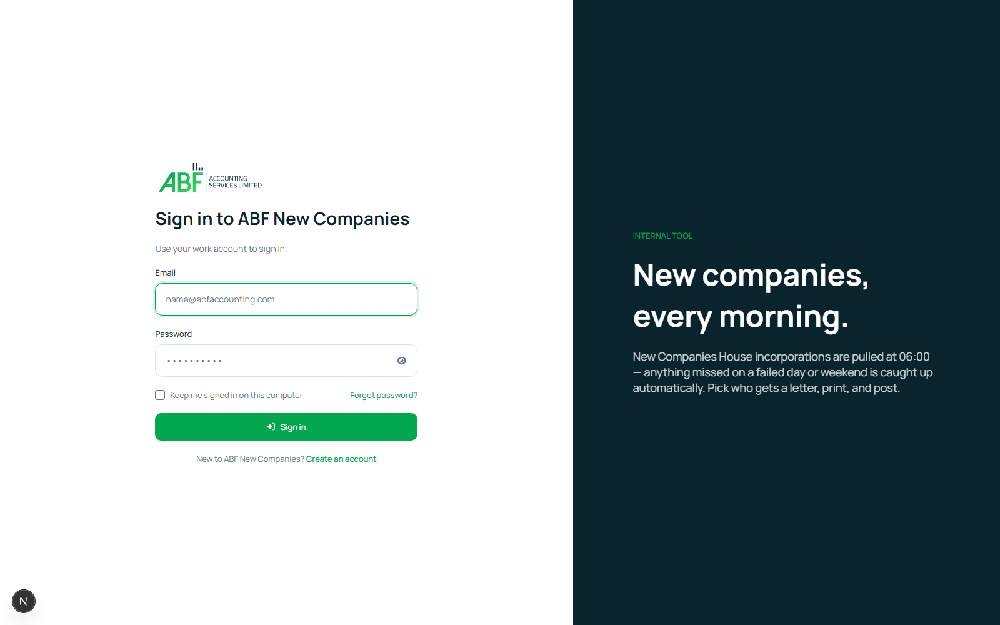

- Sign in with your **abfaccounting.com** email and password. Tick **Keep me signed in** on
  your own computer only.
- **Forgot password?** sends a reset link to your email (valid for a short time).
- After too many wrong passwords the account locks for **15 minutes**. Use "Forgot password"
  or wait.
- If you turned on **two-step sign-in**, enter the 6-digit code from your authenticator app.
  Lost your phone? Use one of your **recovery codes** instead.

---

## 2. What happens every morning

At **06:00 (South Africa time)** the app collects every company incorporated since the last
pull. It checks each one against 7 rules:

| Rule | A company is skipped when… |
| --- | --- |
| Company type | It is not a Ltd, LLP or company limited by guarantee, or it is a **CIC** |
| Address is complete | The address has no street, town or valid UK postcode (it goes to **Address issue**) |
| Not at your own office | It is registered at ABF's own office |
| Not a shared or agent address | 5+ new companies share the address, or 8+ share the postcode, within 14 days (formation agents, virtual offices) |
| Not a Companies House default address | It uses the Companies House "default address" |
| Not excluded | It is on the Excluded (do-not-contact) list |
| Not printed before | It already got a letter |

Companies that pass all 7 are **Not reviewed**, ready for you. The **Companies House** card at
the bottom of the menu shows when the last pull ran; you can also **Run pull now** from there.
If a pull fails it tries again every 30 minutes, and you get an email if it keeps failing
(switch this on in **My account**).

---

## 3. New Companies — choosing who gets a letter

**Tabs:**
- **All**: every company.
- **Not reviewed**: ready, waiting for you.
- **Added to print run**: going into the next print.
- **Sent**: letters already printed.
- **Address issue**: the address needs fixing.
- **Excluded**: on the do-not-contact list.
- **Skipped by rules**: failed one of the rules.

**Filters:**
- **Incorporated**: since the last pull, 7 days, 30 days or any date.
- **Company type**: Ltd, LLP, Limited by guarantee or other.
- **SIC / industry**.
- **Location**: England, Wales, Scotland or Northern Ireland.
- The **search box**: company name or number.

To send letters:

1. Tick the companies (or the box at the top to tick the whole page).
2. Click **Add to print run**. They move to "Added to print run".
3. Click **Go to print (N)** (top right) when you're ready.

To stop a company ever getting a letter, tick it and click **Exclude** (you can give a
reason). Excluded companies are never written to, even after a year.

**The ⋯ menu on each row:**
- View company
- Add to / Remove from print run
- **Fix posting address**: when the registered address is wrong or incomplete, the letter goes
  to the address you enter.
- Open on Companies House
- **Move back to Not reviewed**: for a skipped company you still want to write to.
- Exclude / Remove exclusion

**Export** downloads the list (current filters or ticked rows) as a CSV file for Excel.

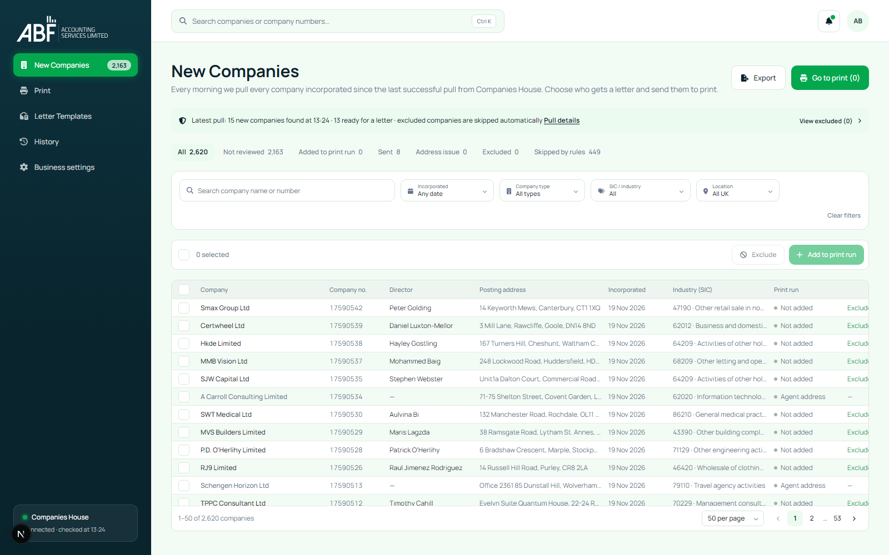

The **Skipped by rules** tab shows why each company was skipped (for example "Agent address"
or "Company type").

---

## 4. A company's page

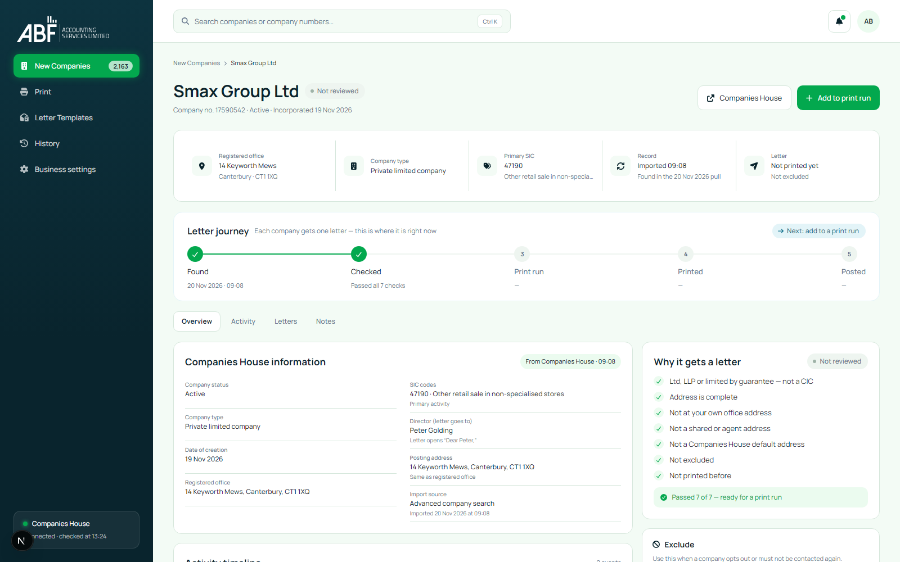

Click any company name to open its page.

- **Letter journey**: where it is now (Found → Checked → Print run → Printed → Posted).
- **Why it gets a letter**: the 7 rules with a tick or cross each.
- **Overview**: Companies House details, the director the letter goes to, the posting address.
- **Activity**: everything that happened to this company, and who did it.
- **Letters**: every letter printed for it, with **View / reprint**. Before it has a letter you
  see a preview of what it will look like.
- **Notes**: internal notes for the team (never printed).

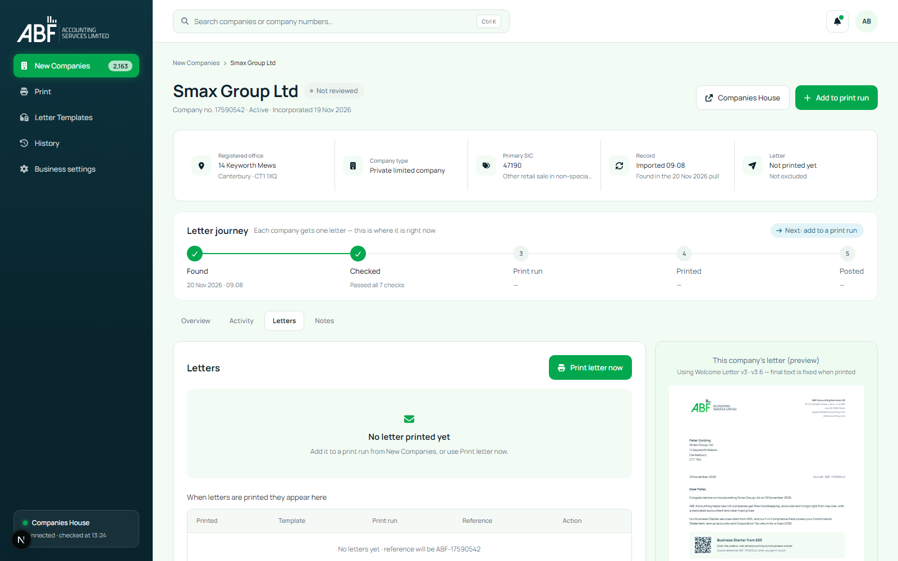

**Print letter now** (Letters tab) prints just this one company's letter straight away,
without waiting for the daily run. It then asks "Did the letter print correctly?", the same as
a normal run.

---

## 5. Printing letters and labels

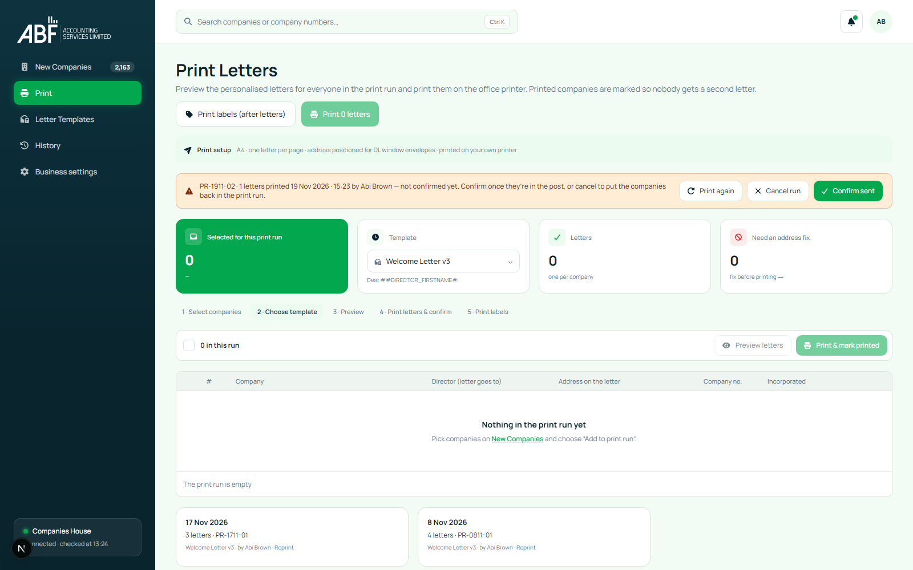

1. Open **Print**. The companies you added are listed, in the order they will print.
2. Pick the **Template** (the default is chosen for you).
3. Click **Preview letters** to see each personalised letter. The dashed box shows where the
   DL envelope window is (it does not print).

   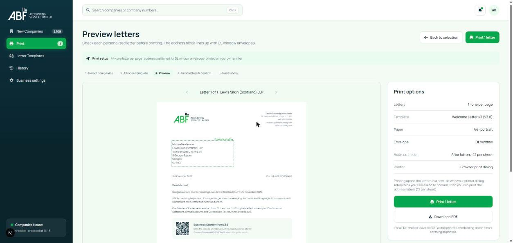

4. Click **Print & mark printed** (or **Print N letters**). The letters open in a new tab:
   print them there on A4 (scale 100%).
5. Come back and answer **Did all letters print correctly?**
   - **Yes — mark sent & print labels**: the companies become Sent, and you can print labels
     next. You can undo for a few seconds.
   - **Not yet — reprint**: opens the letters again.

   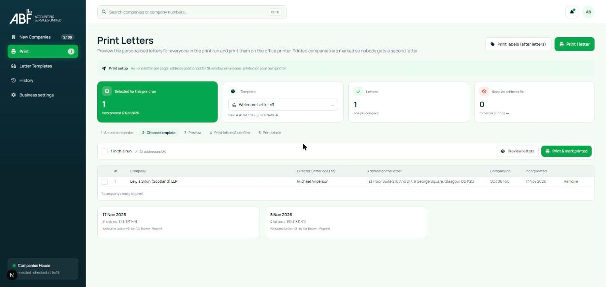

6. **Address labels** (only if you don't use window envelopes): A4 sheets of 12 labels
   (2 × 6, about 98 × 46 mm). Labels come out in the same order as the letters. On a part-used
   sheet choose **Start at label…**. Use **Print a test sheet** the first time.

   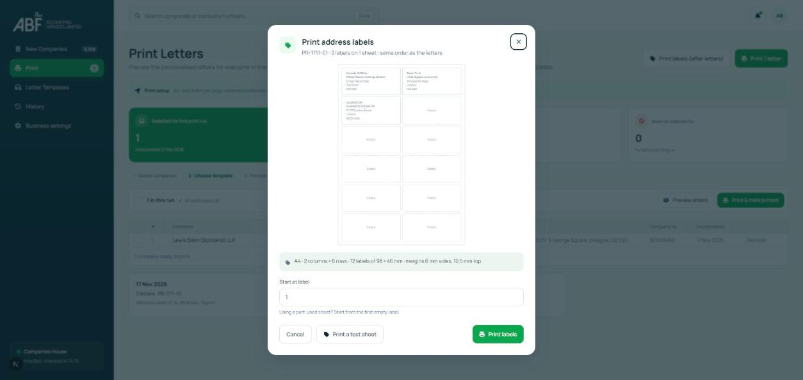

If a run is printed but not yet confirmed, an orange banner on the Print page reminds you,
with **Print again**, **Cancel run** (puts the companies back in the print run) and **Confirm
sent**. A paper jam? Open the run in **History → Print runs** and reprint just the letters
you need. Reprints never change any dates.

---

## 6. Letter templates

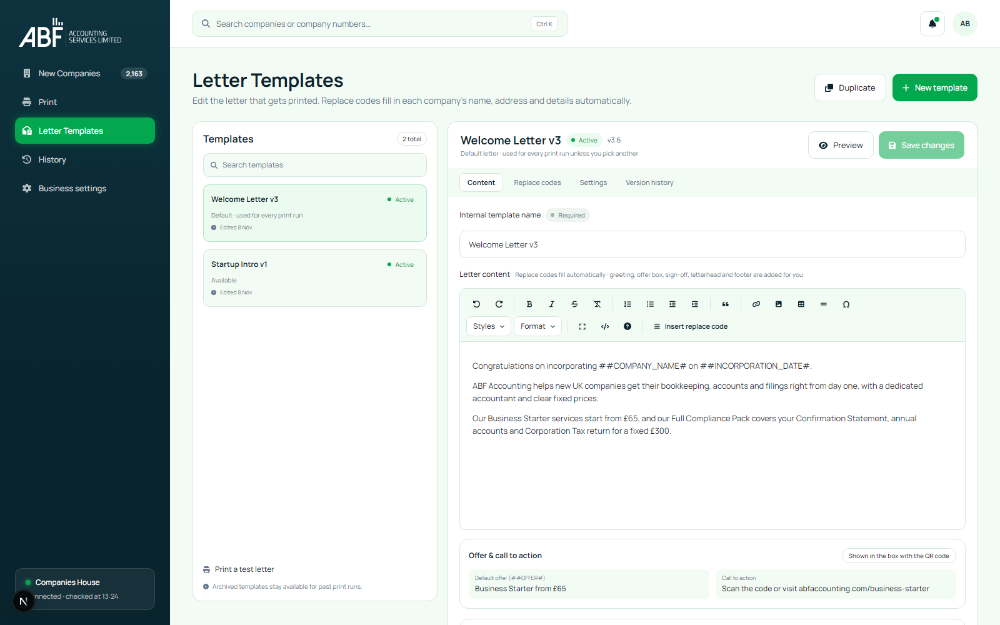

- **Content**: write the letter. As you type, the preview on the right fills in a real
  company.
- **Replace codes** like `##COMPANY_NAME#` or `##DIRECTOR_FIRSTNAME#` are filled in for each
  company when it prints. Click a code to insert it, or use **Insert replace code**. An
  unknown code is flagged.
- **The toolbar:**
  - bold, italic and lists
  - indent and quote
  - **link**: web, email or phone
  - **image**: a public https:// address
  - **table** and **line**
  - **special characters (Ω)**
  - **Styles**: Lead, Small print, Highlight box
  - **Format**: Heading, Subheading
  - **full screen**, **HTML source** and **help**
- The greeting ("Dear Sarah,"), the offer box with QR code, the sign-off, the letterhead and
  the footer are added automatically. Don't type them in the text.
- **Save changes** creates a new version (v3.4 → v3.5). **Version history** lets you view or
  restore any earlier version.
- **Settings tab:**
  - name and status (Active / Draft / Archived)
  - whether it is the default letter
  - greeting, sign-off, **Signed by**, offer and call to action
- **New template** starts a copy or a blank letter; **Duplicate** copies the current one.
- **Print a test letter** prints a sample without recording anything. Always do this after
  changing a letter.

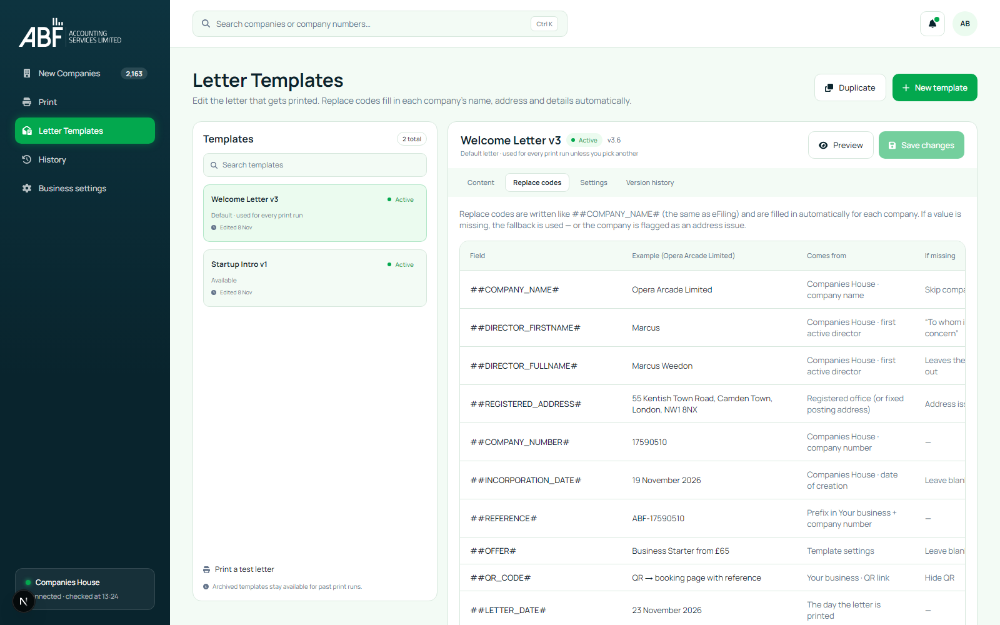

The **Replace codes** tab explains every code, where its value comes from and what prints if
it's missing. For example, with no director name the letter says "To whom it may concern,".

---

## 7. History

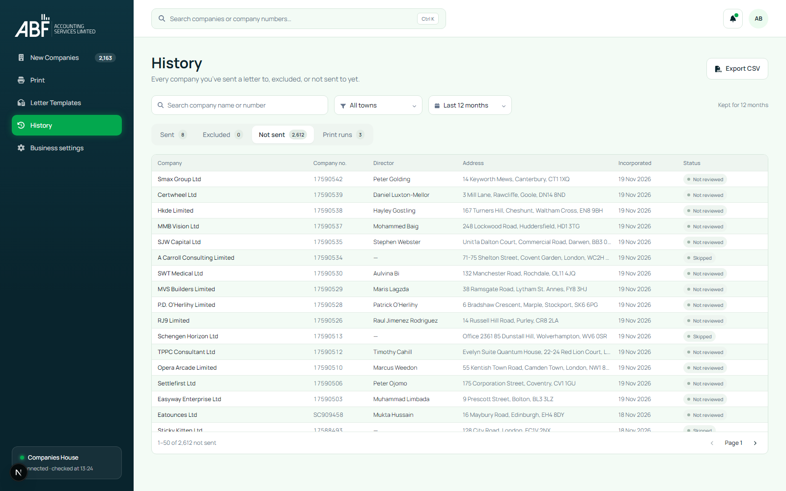

The record of everything, kept for **12 months**:

- **Tabs:**
  - **Sent**: every letter printed, with who printed it and View letter.
  - **Excluded**: the do-not-contact list, with who excluded each company and why.
  - **Not sent**: companies that haven't had a letter.
  - **Print runs**: every run, with **Reprint** and **Reprint labels**.
- **Filters:**
  - search a company name or number
  - **town**
  - **date range**: last 7 days, 30 days, 3 months or 12 months
- **Export CSV** downloads the open tab with the same filters.

Anything older than 12 months is deleted automatically, except the Excluded list, which is
kept for good.

---

## 8. Business settings (admins)

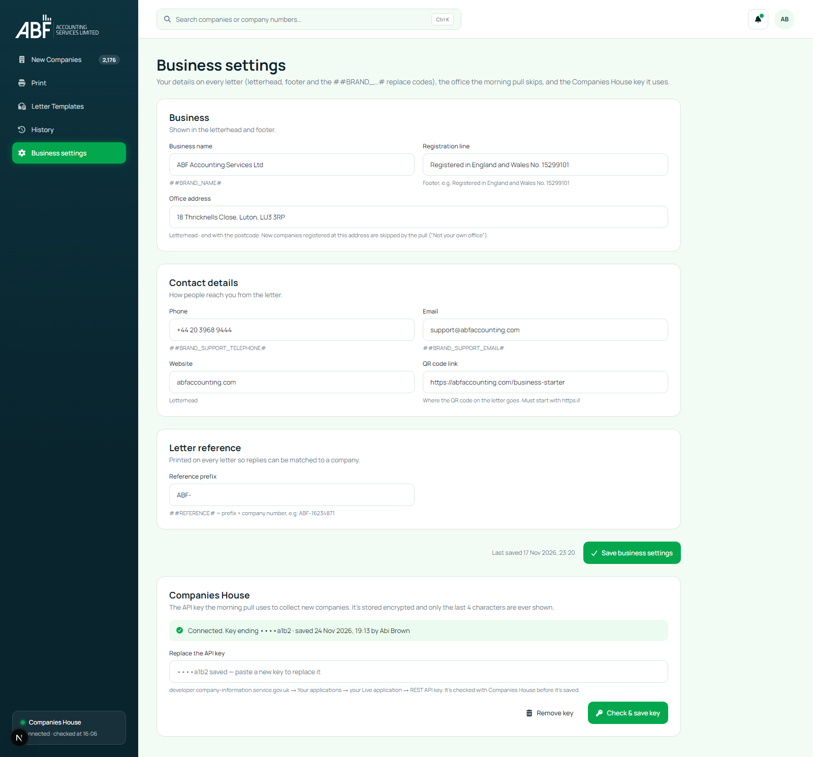

The details printed on every letter:
- business name and registration line
- office address
- phone, email and website
- **QR code link** (where the QR code takes people)
- the reference prefix (`ABF-`)

New companies registered at this office address are skipped automatically. Only admins can
change these; everyone else sees them read-only.

**Companies House** (bottom of the page, admins): the API key the morning pull uses. Paste it
and press **Check & save key**: the app checks it with Companies House first, then stores it
encrypted. Only the last 4 characters are shown. **Remove key** stops the pulls until a new key
is saved. If the menu card says **API key not set**, this is where to fix it.

---

## 9. My account

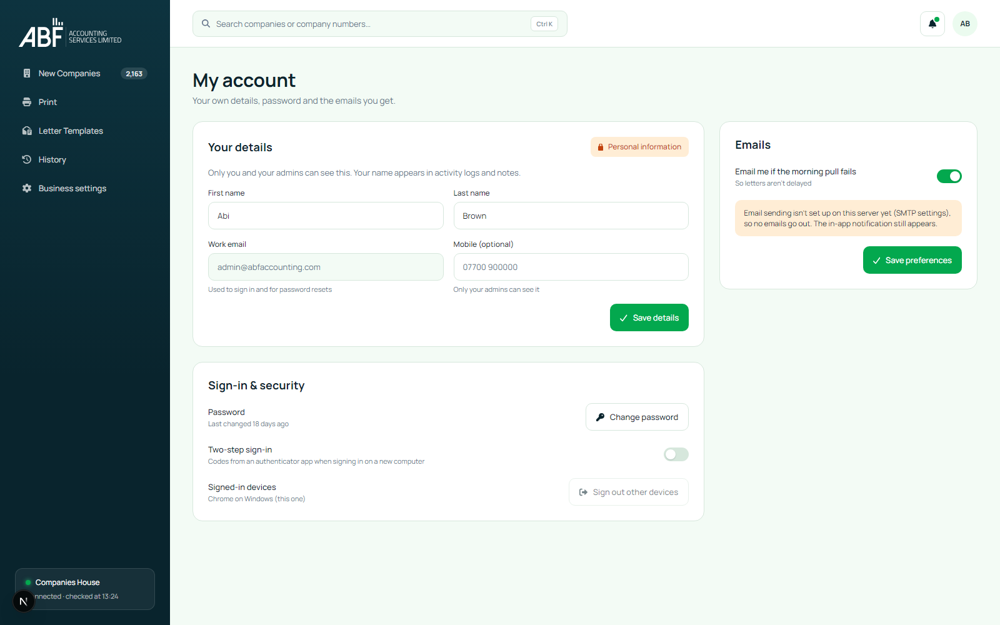

- Change your name and mobile, and your **password**.
- Turn on **Two-step sign-in**. Scan the QR code with an authenticator app (Microsoft or
  Google Authenticator) and save the recovery codes.
- **Sign out other devices** if you signed in somewhere you shouldn't have.
- **Email me if the morning pull fails**: keep this on so letters aren't delayed.

---

## 10. Handy extras

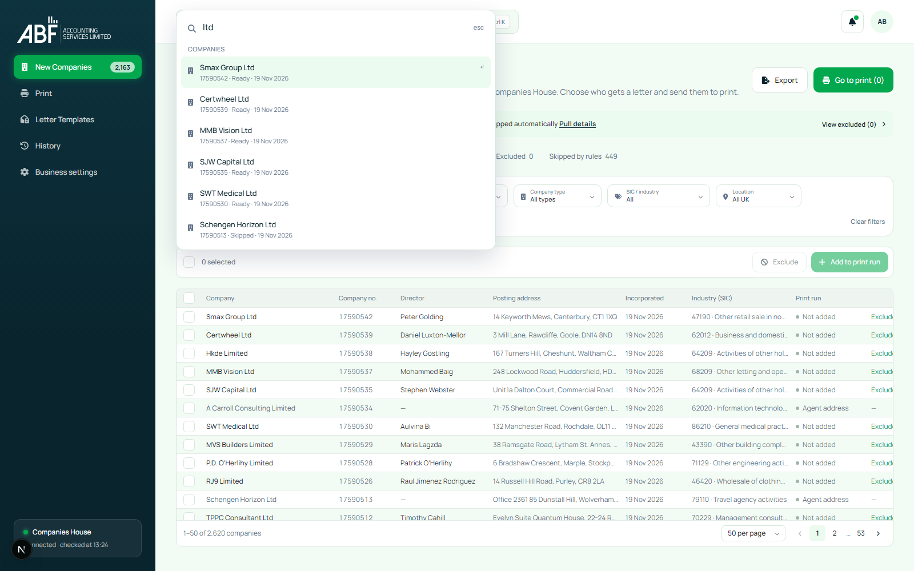

- **Ctrl K** (or click the search bar) finds any company by name or number from any page.
- The **bell** shows news: pull finished, address issues to fix, runs confirmed.
- Lists show 25, 50 or 100 rows per page (bottom right).

---

## Quick answers

| Question | Answer |
| --- | --- |
| A company we want to write to was skipped | Open it → ⋯ → **Move back to Not reviewed**, then add it to the print run. |
| Someone asked us to stop writing | Find them (Ctrl K) → **Exclude**. They'll never get another letter. |
| The address is wrong | ⋯ → **Fix posting address**. The letter uses your address; the Companies House record isn't changed. |
| The printer jammed halfway | Answer "Not yet — reprint", or reprint the missing letters from **History → Print runs**. |
| We printed but forgot to confirm | The orange banner on **Print** → **Confirm sent**. |
| Can a company get two letters? | No. Once printed, it is skipped by the "Not printed before" rule. |
